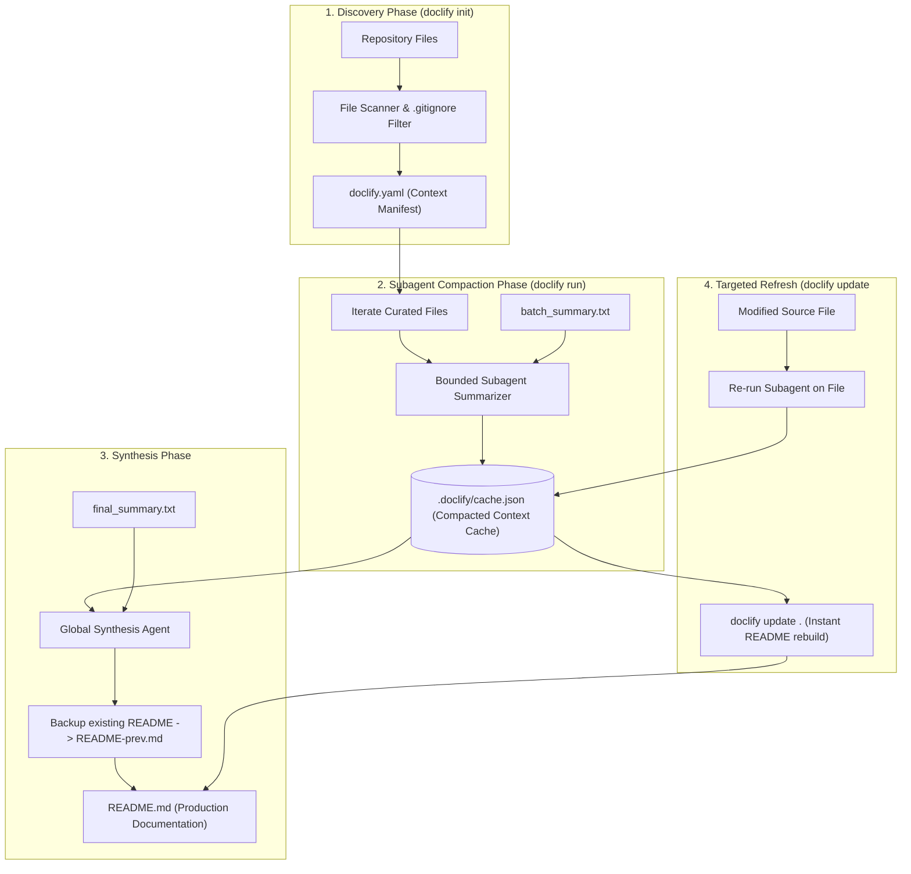

<div align="center">

#  Doclify !

**AI-Native Codebase Documentation Engine & Context Engineering Laboratory**

[](https://github.com/hardikkaurani/Doclify/stargazers)
[](https://github.com/hardikkaurani/Doclify/network/members)
[](https://github.com/hardikkaurani/Doclify/issues)
[](https://www.gnu.org/licenses/agpl-3.0)
[](https://www.python.org/)
[](https://groq.com/)

<p align="center">
  <b>Doclify</b> scans your repository, distills structured context file-by-file through an isolated subagent pipeline, and synthesizes clean, comprehensive, production-grade documentation — entirely from your terminal.
</p>

[Quickstart](#-quickstart) • [Architecture](#-architecture--pipeline-workflow) • [Context Engineering (ACE)](#-the-ace-framework--why-doclify-works) • [CLI Reference](#-cli-command-reference) • [Configuration](#-configuration-doclifyyaml)

</div>

---

## 💡 Overview

Modern AI coding agents frequently stumble in large codebases. The cause is rarely model capability — **it is almost always context pollution and degradation**. When you dump an entire repository into a prompt, context limits saturate, noise drowns out signal, and the agent hallucinates.

**Doclify** is built from the ground up to solve this using **Advanced Context Engineering (ACE)**:
- **Two-Stage Hierarchical Compaction:** Raw code never enters the final synthesis prompt. Each file is distilled into dense semantic summaries first.
- **Subagent Context Isolation:** Summarization runs in bounded, ephemeral context windows so intermediate reasoning noise is discarded.
- **Incremental State Caching:** Distilled summaries are stored in `.doclify/cache.json`, allowing instant updates when individual files change without paying full re-computation costs.
- **Lightning-Fast Inference:** Powered by Groq's high-speed inference engine for near-instant responses.

---

## 🏗 Architecture & Pipeline Workflow

Doclify follows a strict **Research → Plan → Implement** separation inspired by the 12-factor agent pattern:



---

## 🧠 The ACE Framework — Why Doclify Works

Doclify is an empirical implementation of the principles articulated by **Dex Horthy** (founder of HumanLayer) in *[Advanced Context Engineering for Coding Agents](https://github.com/humanlayer/advanced-context-engineering-for-coding-agents/blob/main/ace-fca.md)*:

> *"The contents of your context window are the ONLY lever you have to affect the quality of your output."*

| ACE Principle | Problem in Naive Approaches | Doclify's Implementation |
| :--- | :--- | :--- |
| **Stateless LLMs** | Expecting models to "remember" or infer cross-file context without structure. | Prompts (`doclify/prompts/`) are treated as primary versioned source code. |
| **Frequent Intentional Compaction (FIC)** | Context windows get saturated (80%+ capacity), causing hallucination and lost details. | **Target 40–60% window:** 500 lines of source code are compressed into 3–4 dense summary sentences. |
| **Subagent Context Isolation** | Giant single-prompt runs leak tool logs, dead ends, and intermediate code tokens into final generation. | Each file summary runs in an isolated subagent inference call. The parent only receives distilled output. |
| **Incremental State Persistence** | Re-running full docs on every minor change is expensive, slow, and wasteful. | Distilled state is cached in `.doclify/cache.json`. `doclify update <file>` recalculates only the diff. |
| **Research → Plan → Implement** | Blurring code inspection and generation results in shallow, poorly structured summaries. | `init` does zero inference (pure discovery); `run` compiles summaries into documentation. |

---

## 🚀 Quickstart

### 1. Installation

Install Doclify in your environment:

```bash
# Clone the repository
git clone https://github.com/hardikkaurani/Doclify.git
cd Doclify

# Install in editable mode with pip
pip install -e .

# Or using uv
uv pip install -e .
```

### 2. Configure Your Groq API Key

Doclify uses Groq's high-speed inference engine. Get your free API key at [console.groq.com](https://console.groq.com/).

```bash
# Windows PowerShell
$env:GROQ_API_KEY="gsk_your_groq_api_key_here"

# Windows Command Prompt
set GROQ_API_KEY=gsk_your_groq_api_key_here

# Linux / macOS
export GROQ_API_KEY="gsk_your_groq_api_key_here"
```

*Alternatively, create a `.env` file in your project root:*
```env
GROQ_API_KEY=gsk_your_groq_api_key_here
```

### 3. Generate Documentation in 3 Steps

```bash
# Step 1: Scan repository and generate context manifest
doclify init

# Step 2: (Optional) Explore and choose an LLM model
doclify models
doclify set default llama-3.3-70b-versatile

# Step 3: Run the documentation pipeline
doclify run
```

---

## 📖 CLI Command Reference

Doclify provides an intuitive CLI powered by `click` and `rich`:

### `doclify init`
Scans the current directory, respects `.gitignore`, creates `.doclify/`, and generates `doclify.yaml`.
```bash
doclify init
```
> [!NOTE]
> Re-running `doclify init` is safe: it discovers newly created files while preserving your customized model settings.

---

### `doclify models`
Fetches a live, beautifully formatted table of all active Groq models, sorted alphabetically by developer with context windows and speed limits.
```bash
doclify models
```

---

### `doclify set default <model_id>`
Configures the default LLM model in `doclify.yaml`.
```bash
doclify set default llama-3.3-70b-versatile
# or
doclify set default qwen/qwen3-32b
```

---

### `doclify run`
Executes the full two-stage documentation pipeline. If a `README.md` already exists, Doclify automatically backs it up to `README-prev.md`.
```bash
# Standard run
doclify run

# Override model temporarily for this run
doclify run --model llama-3.3-70b-versatile
```

---

### `doclify update <path>`
Selectively refreshes documentation for modified files without re-processing the entire project.
```bash
# Update cache for a specific file
doclify update src/services/auth.py

# Rebuild README instantly from existing cache (zero file re-summarization)
doclify update .
```

---

## ⚙️ Configuration (`doclify.yaml`)

After running `doclify init`, a `doclify.yaml` configuration is created:

```yaml
project: Doclify
structure:
  - doclify/__init__.py
  - doclify/components/init.py
  - doclify/components/run.py
  - doclify/components/update.py
  - doclify/pipelines/supervisor.py
  - doclify/utils/llm.py
llm:
  model: qwen/qwen3-32b
  provider: groq
```

- **`project`**: The title and scope of your repository.
- **`structure`**: The explicit context manifest. You can manually prune noisy files or add custom documentation paths.
- **`llm.model`**: The target model ID from Groq.
- **`llm.provider`**: Provider identifier (defaults to `groq`).

---

## 📁 Repository Structure

```
Doclify/
├── doclify/
│   ├── components/         # Core CLI actions
│   │   ├── config.py       # Configuration manager
│   │   ├── init.py         # Repo discovery & doclify.yaml creation
│   │   ├── models.py       # Groq model catalog viewer
│   │   ├── run.py          # Stage 1 & Stage 2 documentation pipeline
│   │   └── update.py       # Selective cache refresh & instant rebuild
│   ├── config/             # Constants & configuration defaults
│   │   └── constants.py
│   ├── pipelines/          # CLI command supervisor
│   │   └── supervisor.py   # Click command groups & routing
│   ├── prompts/            # Version-controlled prompt engineering assets
│   │   ├── batch_summary.txt  # Stage 1 per-file summarization prompt
│   │   └── final_summary.txt  # Stage 2 global README synthesis prompt
│   ├── resources/          # Language templates (.gitignore defaults)
│   ├── schema/             # Pydantic data schemas
│   │   └── schema.py
│   └── utils/              # Helper utilities
│       ├── extract.py      # Code reading & syntax processing
│       ├── file_utils.py   # File system & cache operations
│       ├── llm.py          # Groq client integration
│       ├── logger.py       # Rich terminal logging
│       ├── readme.py       # Safe README file operations
│       └── scanner.py      # .gitignore-aware directory scanner
├── main.py                 # Application launcher
├── pyproject.toml          # Package metadata & dependencies
└── LICENSE                 # GNU AGPLv3 License
```

---

## 🤝 Contributing

Contributions, issues, and feature requests are welcome!

1. Fork the Project: `https://github.com/hardikkaurani/Doclify`
2. Create your Feature Branch: `git checkout -b feature/AmazingFeature`
3. Commit your Changes: `git commit -m 'feat: add AmazingFeature'`
4. Push to the Branch: `git push origin feature/AmazingFeature`
5. Open a Pull Request

---

## 📜 License

Distributed under the **GNU Affero General Public License v3.0 (AGPLv3)**. See [`LICENSE`](LICENSE) for more information.

---

<div align="center">
  <sub>Maintained with ❤️ by <a href="https://github.com/hardikkaurani">Hardik Kaurani</a>. Inspired by Dex Horthy's ACE Research.</sub>
</div>
